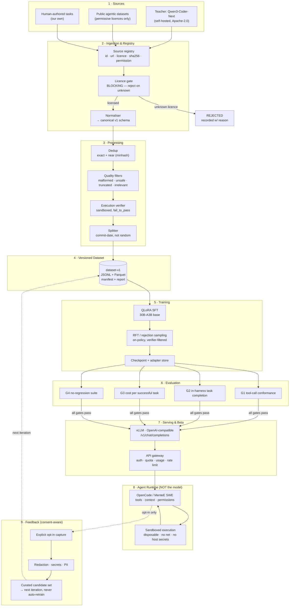

# System Architecture

> Design rule from the source blueprint: **"Prefer simple, replaceable components."**
> No Kubernetes. No Kafka. No distributed training. One 24 GB card trains the student; one
> 48 GB card serves the teacher; one 24 GB card serves the beta. Every component below has a
> single-purpose replacement path.

---

## 1. Full system diagram



---

## 2. The one boundary that must not blur: model vs runtime

The blueprint called this out and it is the most commonly confused line in agent products.

| | **MenteE Code 3B (the model)** | **The agent runtime** |
|---|---|---|
| Owns | next token; tool-call *emission* | tool *execution*; file I/O; repo context; permissions; verification; retries; cost control |
| Knows | the conversation, the tool schemas, the instructions | the filesystem, the shell, the git state, the secrets policy |
| Decides | *what* to do next | *whether* it is allowed, and *whether it worked* |
| Must never | execute a command, touch a secret, decide its own success | generate code |
| Failure mode | hallucinates a tool that does not exist, or claims success | trusts the model's claim instead of checking |

> **Rule:** the model may only *propose*. The runtime *disposes*.
> A model that is told "the test passed" without the runtime having run it is a bug, and the
> MenteE SWE principle — **never claim success without proof** — is a runtime invariant,
> not a prompt request. ✅

**Consequence for MenteE Code 3B's training data:** every trajectory in the dataset must
contain the *ground truth* about what happened (which tests ran, what they returned), not
just what the model said. This is why the schema (§`04-DATA-SCHEMA.md`) has a separate
`verification` block instead of trusting the assistant's final message. 🎯

---

## 3. Component responsibilities

| # | Component | Responsibility | Replaceable because |
|---|---|---|---|
| 1 | **Source registry** | Every dataset has an id, URL, licence SPDX id, pinned sha256, and an explicit "may we train on this and redistribute it?" boolean | Data lives behind a registry entry; the loader is generic |
| 2 | **Licence gate** | Blocks ingest on unknown/restrictive licence. Emits a rejection record with reason | One function; the policy is a YAML list |
| 3 | **Normaliser** | Maps any source format → canonical schema v1 | Per-source adapter; the schema is the contract |
| 4 | **Dedup** | Exact hash + near-duplicate (minhash/SimHash) across *and within* sources | Algorithm swappable; thresholds in config |
| 5 | **Quality filters** | Malformed, unsafe (secrets, malware, exfil), truncated, irrelevant, unverifiable | Rule set in config, each rule logs its own rejection count |
| 6 | **Execution verifier** | Runs the candidate solution in a disposable sandbox; computes `fail_to_pass` / `pass_to_pass` | Docker → Firecracker → any runner; emits one JSON verdict |
| 7 | **Splitter** | Splits by **repo commit date**, never randomly, to prevent benchmark leakage | Policy file; date bounds are config |
| 8 | **Dataset store** | Immutable, versioned snapshots: JSONL canonical + Parquet analytical + manifest + quality report | Object storage; local dir works too |
| 9 | **Trainer** | QLoRA SFT → RFT. Config-as-code, resumable, seeded | Swap Unsloth ↔ plain PEFT ↔ TRL without touching the data |
| 10 | **Checkpoint store** | Adapters, configs, metrics, dataset version stamp, git SHA | Directory + HF; no bespoke format |
| 11 | **Eval harness** | G1–G4, plus a 50-task in-harness suite | Runs against any OpenAI-compatible endpoint → base and student compared identically |
| 12 | **Serving** | vLLM, OpenAI-compatible, streaming, tool-call parser | SGLang / llama.cpp / a managed endpoint |
| 13 | **Gateway** | Auth, per-key quota, rate limit, usage accounting, spend cap, kill switch | LiteLLM-style proxy or ~200 lines of our own |
| 14 | **Agent runtime** | OpenCode / MenteE SWE | Not ours to own in the beta — which is exactly why the eval suite lives *inside* it |
| 15 | **Sandbox** | Disposable execution, resource caps, no network, no host secrets | Docker → gVisor → Firecracker |
| 16 | **Feedback pipeline** | Opt-in capture → redaction → curation → candidate set. **Never** auto-retrains | Curation is a human-in-the-loop review queue |

---

## 4. Repository structure

```
mentee-code-3b/
├── docs/                          # ← you are here
│   ├── 00-EXECUTIVE-SUMMARY.md
│   ├── 01-THESIS-300B-CLASS.md
│   ├── 02-BASE-MODEL-SELECTION.md
│   ├── 03-ARCHITECTURE.md
│   ├── 04-DATA-SCHEMA.md
│   ├── 05-DATA-COLLECTION-PLAYBOOK.md
│   ├── 06-TRAINING.md
│   ├── 07-EVALUATION.md
│   ├── 08-SERVING-AND-BETA.md
│   ├── 09-COST-MODEL.md
│   ├── 10-ROADMAP-AND-BACKLOG.md
│   ├── 11-RISKS-AND-OPEN-QUESTIONS.md
│   └── 12-OPEN-QUESTIONS.md
│
├── schemas/
│   ├── mentee-trajectory-v1.schema.json      # canonical schema, machine-checkable
│   ├── source-registry-v1.schema.json        # licence manifest
│   └── examples/
│       └── example-trajectory.json
│
├── configs/
│   ├── base_model_matrix.json                # candidate matrix (from doc 02)
│   ├── dataset_config.json                   # sources, filters, split policy
│   ├── train_config.yaml                     # SFT hyperparameters
│   ├── rft_config.yaml                       # rejection-sampling config
│   ├── eval_config.yaml                      # G1–G4 thresholds
│   └── serve_config.yaml                     # vLLM args, quant, context
│
├── src/
│   ├── registry/        # source registry + licence gate
│   ├── ingest/          # per-source adapters
│   ├── schema/          # canonical model + validator
│   ├── process/         # dedup, filters, splitter
│   ├── verify/          # sandboxed execution verifier
│   ├── train/           # SFT + RFT
│   ├── eval/            # G1 conformance, G2 harness, G3 cost, G4 regression
│   ├── serve/           # vLLM launch, gateway, quotas
│   └── cli.py           # one entrypoint, subcommands per stage
│
├── data/                # gitignored; large artefacts live outside the repo
│   ├── raw/  processed/  manifests/  reports/
│
├── models/              # checkpoints, adapters, logs
├── reports/             # quality reports, eval results, model card
└── .gitignore  README.md  Makefile  pyproject.toml
```

**Modelling on the sibling `mentee-embeddings` repo** ✅, which already uses the
`configs/ → scripts/ → reports/ → models/` shape, a `preflight` check, a `RUNBOOK`, a
`MODEL_CARD`, and an `upload_hf.py`. The pattern works; do not invent a new one.

---

## 5. Deliberate simplicity decisions

| Decision | Alternative | Why we chose it | Reversal cost |
|---|---|---|---|
| Single 24 GB card for training | Multi-GPU FSDP | 17.5 GB fits; no distributed complexity | Low — scale later if data grows |
| JSONL canonical, Parquet optional | Parquet only | JSONL is diffable, streamable, trivially inspectable; Parquet for analysis | Trivial |
| vLLM for serving | SGLang / Triton / managed | OpenAI-compatible out of the box, `--tool-call-parser qwen3_coder` ✅ | Low |
| Self-hosted teacher | Closed API | Licence cleanliness + cost (§`09-COST-MODEL.md`) | Medium — regenerating data |
| Unsloth first, plain PEFT second | Only one | Unsloth's 17.5 GB QLoRA gets us to a result fastest; plain PEFT is the reproducible fallback | Low |
| Config-as-code (YAML/JSON) | Notebooks | Reproducibility. `mentee-embeddings` already does this ✅ | Low |
| Git for the repo, object storage for data | Everything in git | Datasets are large; git is for code + configs + reports + manifests | — |

---

## 6. Data flow invariants

These are the rules that, if broken, silently corrupt the project.

1. **Nothing enters the dataset without a registry entry and a passing licence gate.**
2. **No trajectory is marked `verified: true` unless the verifier actually ran it.** No
   exceptions, no "probably fine".
3. **Splits are by commit date.** A random split leaks the future into the training set and
   inflates every number.
4. **The base model is never trained on its own outputs unless the teacher is different
   from the base** — with a self-hosted teacher this is satisfied by construction, and the
   `teacher_model` field makes it auditable.
5. **The chat template comes from the base model's tokenizer.** Never hand-rendered.
6. **Every checkpoint records the dataset version, the git SHA, the base model id, and the
   full config.** A checkpoint without those is not reproducible and is not a release.
7. **Every rejected example is counted by reason.** A dataset that dropped 60% of its input
   without saying why is not auditable.
8. **The beta never auto-trains.** Feedback goes to a human-reviewed candidate set.
